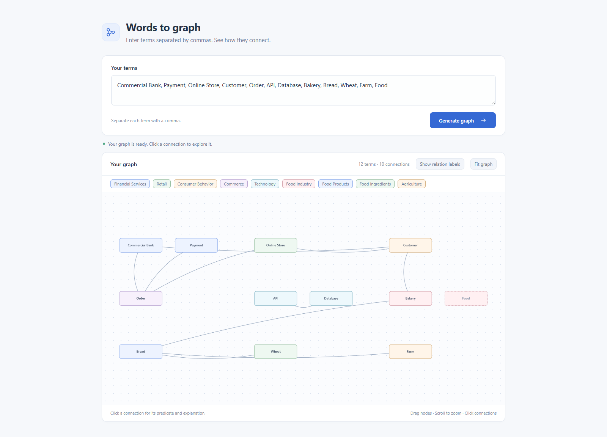
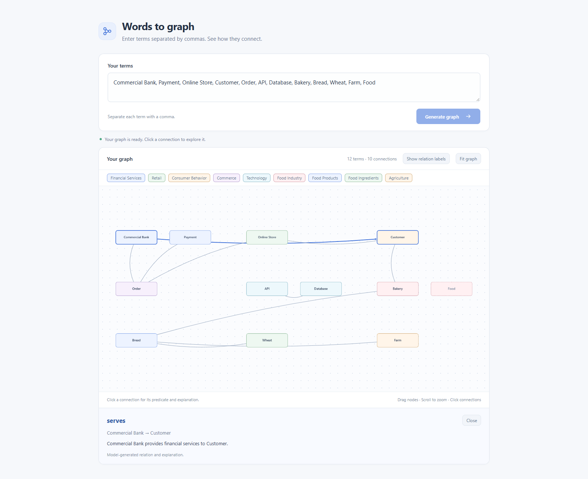
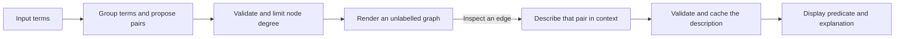

# Word to Graph

**Turn a list of terms into an interactive graph, then ask the local model what each connection means.**

Word to Graph explores a practical problem in AI interfaces: a useful graph needs clear structure before it needs a label on every edge. The application groups terms across one or several domains, proposes a sparse topology, and generates relationship descriptions only when you inspect a connection.



<details>
<summary>See a relationship explanation</summary>



</details>

## What you can do

- Enter 2–200 comma-separated terms from any combination of domains.
- Explore a graph with cluster colors, draggable nodes, zoom, and a **Fit graph** control.
- Click a connection to see its proposed predicate, direction, and a one-sentence explanation.
- Show or hide relation labels. Previously described connections are cached.

The interface runs on your workstation. Inference uses **Qwen2.5-3B-Instruct** on an NVIDIA GPU; the application does not call a hosted model API. There is no training step or dataset prerequisite.

## Engineering approach

The pipeline separates two tasks with different costs and output requirements:



**Structure first.** The first phase produces clusters and connected pairs without generating predicates or explanations. Every input term remains a node. Node degree is capped at three by default, or four through the API. Duplicate pairs are merged, and pruning balances coverage without inventing replacement links. Terms can remain isolated when the model finds no useful connection.

**Descriptions on demand.** The second phase sees the selected pair, the input terms, and their clusters. It proposes a precise predicate and a short explanation in that context. Predicates are not selected from a finance or food template. If the model cannot support a relationship, it can return an uncertain result with no predicate. Direction is added after description without changing the original connected pair.

**Explicit output contracts.** JSON-schema-constrained decoding restricts generated endpoints to the input terms. Pydantic validates cluster coverage, pair uniqueness, degree limits, and description endpoints. These checks enforce structural consistency; they do not certify the model's factual claims.

**Bounded local inference.** A single background worker keeps the model loaded and serializes GPU work. Job polling reports progress without blocking the browser. Description caches avoid repeated inference, and frontend request handling prevents late replies from overwriting the currently selected edge or a replacement graph.

**Large-list handling.** Lists of up to 24 terms use one topology call. Larger lists receive a complete cluster assignment, followed by passes of 24 source terms. Each pass retains all input terms as possible targets, so batching does not exclude connections across batches or domains.

## Run locally

Requirements: **Python 3.12**, an **NVIDIA GPU with CUDA and BF16 support**, and internet access for initial dependency installation and model download. Default inference uses BF16. The server listens on `127.0.0.1`.

From the project directory in Windows PowerShell:

```powershell
.\setup_environment.ps1
.\start_web_ui.ps1
```

The browser opens at **http://127.0.0.1:8000**. Wait for the model to finish loading, enter terms, and select **Generate graph**. Stop the server with **Ctrl+C**.

The first launch downloads model weights into `.cache/model`. Later launches use those local files, so a hosted inference service or API key is unnecessary. Existing model files can be supplied with `--model`.

Optional 4-bit inference reduces GPU memory use:

```powershell
.\.venv\Scripts\python.exe -m pip install bitsandbytes==0.47.0
.\start_web_ui.ps1 --quantization 4bit
```

To change the port, start directly, or use an existing model directory:

```powershell
.\start_web_ui.ps1 --port 8001
.\.venv\Scripts\python.exe web_ui.py
.\.venv\Scripts\python.exe web_ui.py --model "C:\path\to\model"
```

Model weights, virtual environments, and generated files are excluded from Git. The repository contains the application source and tests rather than training data or checkpoints. Qwen weights are downloaded separately and governed by the model's research license; see [third-party notices](THIRD_PARTY_NOTICES.md).

## API

| Endpoint | Purpose |
| --- | --- |
| `POST /api/generate-topology` | Group terms and propose sparse connected pairs. |
| `POST /api/describe-relation` | Describe one pair or a list of active edges. |
| `GET /api/jobs/{job_id}` | Poll queued, running, completed, or failed work. |
| `GET /api/status` | Check model readiness. |

Generate a topology:

```json
{
  "terms": ["API", "Database", "Client"],
  "max_degree": 3
}
```

The endpoint returns `202 {"job_id":"..."}`. Poll the job until `state` is `done` or `error`. A completed topology includes `topology_id`, nodes, clusters, connected pairs, and the graph payload used by the UI. The API also accepts comma-separated `{"words":"API, Database, Client"}`.

Describe an existing connection using the returned topology ID:

```json
{
  "topology_id": "...",
  "source": "API",
  "target": "Database"
}
```

An uncached request returns a job ID; a cached description returns `200` immediately. Each result contains `source`, `target`, `predicate`, `explanation`, and `supported`. A batch may supply an `edges` array of up to 32 pairs; the model describes each pair independently. An unsupported relationship returns `supported: false` and `predicate: null`.

## Project layout

```text
word_graph/           Inference, topology generation, schemas, and HTTP server
web/                  Browser UI and local Cytoscape assets
tests/                Structural, API, and browser regression checks
docs/images/          Screenshots from the running application
web_ui.py             Application entry point
setup_environment.ps1 Windows environment setup
start_web_ui.ps1      Windows launcher
```

The backend uses Python's standard-library HTTP server, PyTorch, Transformers, Pydantic, and LM Format Enforcer. The frontend uses JavaScript and Cytoscape.js without a frontend build step.

## Validation and limitations

Run the automated suite:

```powershell
.\.venv\Scripts\python.exe -m unittest discover -s tests -p "test_*.py"
```

The tests cover sparse degree limits, cluster coverage, endpoint restrictions, complete target context across batches, deferred labeling, description caching, and API validation. Browser regression checks exercise edge inspection, label toggling, and stale-response handling.

GitHub Actions runs the unit suite without a GPU or downloaded model. To run the optional browser checks, install `requirements-dev.txt` and a Playwright browser:

```powershell
.\.venv\Scripts\python.exe -m pip install -r requirements-dev.txt
.\.venv\Scripts\python.exe -m playwright install chromium
.\.venv\Scripts\python.exe tests/browser_topology_races.py
.\.venv\Scripts\python.exe tests/browser_topology.py --url http://127.0.0.1:8000
```

The last command needs the running app and exercises real model inference. Browser screenshots and reports go to `.cache/validation`, which is ignored by Git.

Model inference takes time, especially for long lists or when requesting labels for every edge. The current backend requires CUDA and is intended for a local desktop workstation. It does not provide a public deployment configuration.

The graph is a set of **model-generated suggestions**. Connections, predicates, and directions can be wrong even when an explanation sounds plausible. Review the relationships before using them as ontology assertions or as a basis for decisions.
